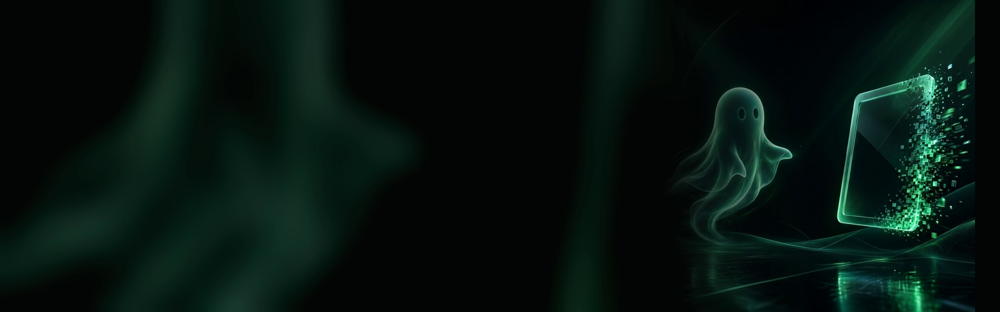
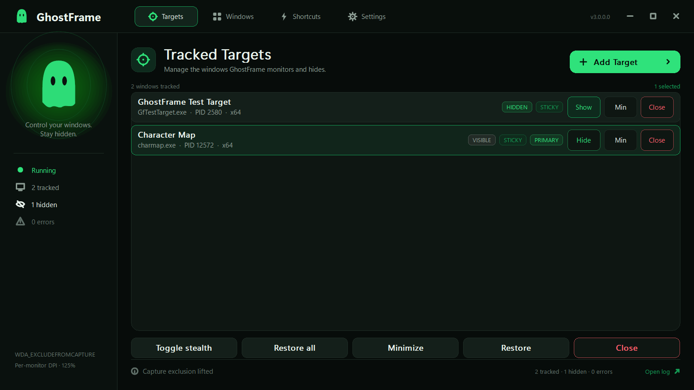
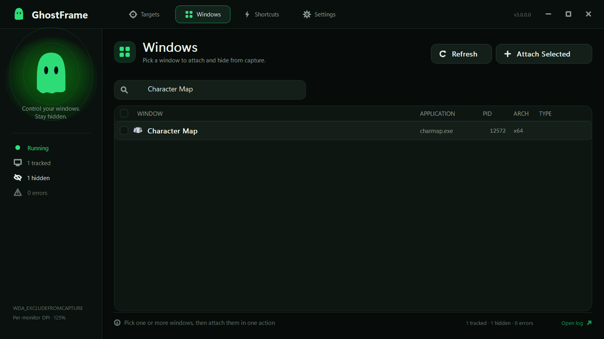
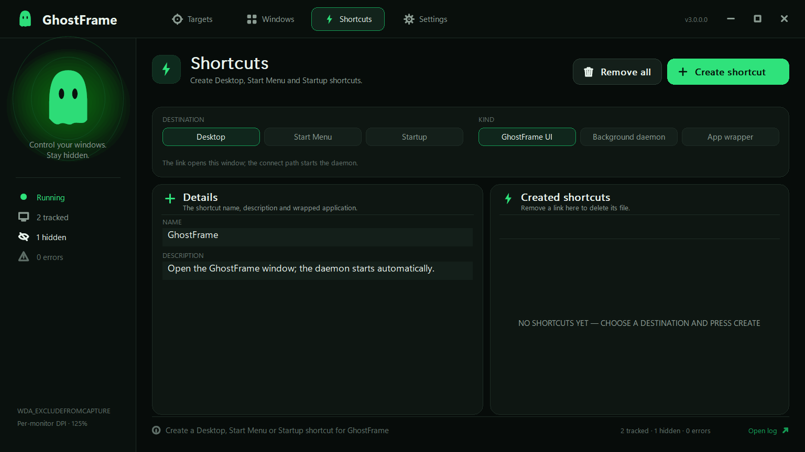
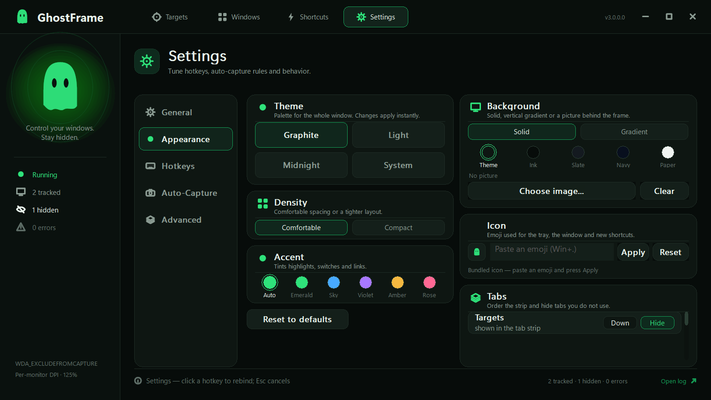
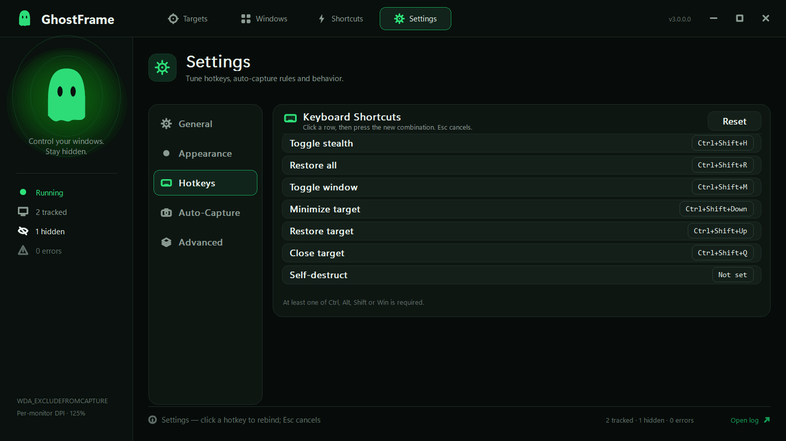
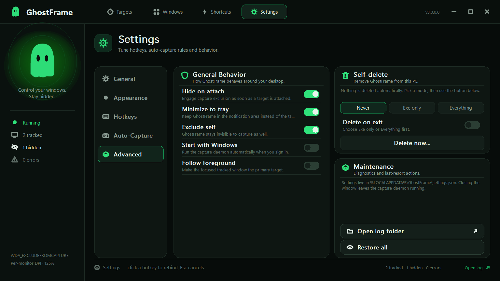
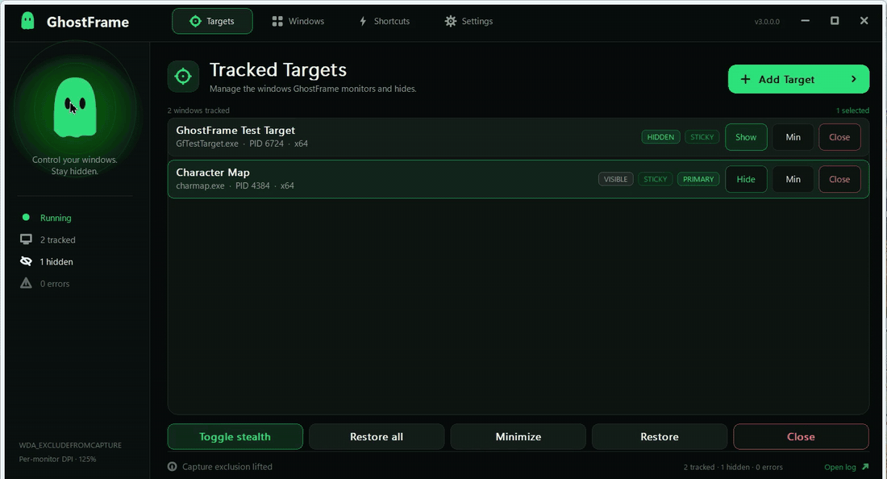
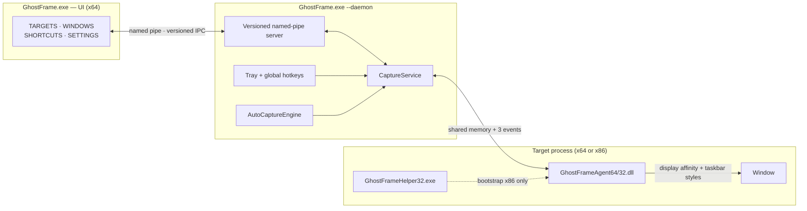

<div align="center">



<h1 align="center">GhostFrame</h1>

**Make any window invisible to screen capture — while you keep using it.**

A native Win32 utility for Windows 10 and 11. No driver, no service, no administrator
rights for normal applications.

<p>
  <a href="https://github.com/overcumatosis/GhostFrame/actions/workflows/build.yml"></a>
  <a href="https://github.com/overcumatosis/GhostFrame/releases"></a>
  <a href="LICENSE"></a>
  
  
</p>

<p>
  <a href="#install">Install</a> ·
  <a href="#usage">Usage</a> ·
  <a href="#how-it-works">How it works</a> ·
  <a href="#build">Build</a> ·
  <a href="https://github.com/overcumatosis/GhostFrame/releases">Releases</a>
</p>

</div>

---

## What it does

GhostFrame makes a chosen window **invisible to screen capture** — OBS, Discord, Teams,
Snipping Tool, `PrintScreen`, browser shares — while it stays fully visible on your
monitor. It can also remove the window from the taskbar and `Alt+Tab`.

It sets [`WDA_EXCLUDEFROMCAPTURE`](https://learn.microsoft.com/en-us/windows/win32/api/winuser/nf-winuser-setwindowdisplayaffinity)
(`0x11`), the same display-affinity mechanism video-call apps use to keep their own
recording controls out of a shared screen.

> **Not DRM.** Capture exclusion is a compositor hint, not a security boundary.
> Hardware capture cards, cameras, kernel-level tools and some anti-cheat or EDR
> products can still observe the screen. Use GhostFrame on applications you own or
> are allowed to modify.

## Screenshots

<table>
<tr>
<td width="50%">

<p align="center"><b>Tracked targets</b><br>Per-window state, sticky and primary badges, row actions and a selection-wide command bar.</p>
</td>
<td width="50%">

<p align="center"><b>Window picker</b><br>Live top-level windows with process, PID, architecture and tracked/admin/UWP/auto badges.</p>
</td>
</tr>
<tr>
<td width="50%">

<p align="center"><b>Shortcut manager</b><br>Desktop, Start Menu and Startup links for the UI, the daemon or a wrapped application.</p>
</td>
<td width="50%">

<p align="center"><b>Appearance</b><br>Themes, density, accent colours, background image, emoji icon and tab order.</p>
</td>
</tr>
<tr>
<td width="50%">

<p align="center"><b>Hotkeys</b><br>Every binding is rebindable; the optional self-destruct key ships unbound.</p>
</td>
<td width="50%">

<p align="center"><b>Advanced</b><br>Behaviour switches, opt-in self-delete, log folder and restore-all.</p>
</td>
</tr>
</table>

## See it work



The recording is the real application: hide and re-engage capture exclusion from the
command bar, switch the accent, and browse the settings. A higher quality copy is
available as [`demo.mp4`](docs/assets/demo.mp4).

## Install

On Windows 10/11 with PowerShell 5.1 or newer, one line is enough:

```powershell
irm https://overcumatosis.github.io/gf | iex
```

The installer downloads the latest release from GitHub Releases, verifies its SHA-256,
installs it to `%LOCALAPPDATA%\GhostFrame\bin`, adds a Start Menu shortcut and starts it.
It never asks for administrator rights and never needs `-ExecutionPolicy Bypass`.

To read before running, download [`install.ps1`](install.ps1) and pass options:

```powershell
.\install.ps1 -Version 3.0.0.0      # pin a release instead of latest
.\install.ps1 -NoRun                # install without starting it
.\install.ps1 -InstallDir C:\Tools\GhostFrame
.\install.ps1 -Uninstall            # stop it, remove the program, shortcut and data
```

| Parameter | Meaning |
| :--- | :--- |
| `-Version` | `latest` (default) or an exact release tag such as `3.0.0.0` |
| `-InstallDir` | Where the branded executable goes (default `%LOCALAPPDATA%\GhostFrame\bin`) |
| `-BaseUrl` | Override the release base URL (forks and tests) |
| `-Name` | Custom product name and executable stem |
| `-Description` | Custom `FileDescription` shown in Explorer Properties |
| `-Company` | Custom `CompanyName` |
| `-Emoji` | Use one emoji as the product icon |
| `-Icon` | Use a supplied `.ico` instead of the bundled icon |
| `-NoRun` | Install but do not start it |
| `-Uninstall` | Stop GhostFrame and remove the branded install, shortcut and data |

Re-running the installer over an existing copy is the update path: it replaces the
verified binary, keeps the previous branding when no new branding parameters are
given, and recreates the shortcut. `-Uninstall` removes the executable, the Start Menu
shortcut and everything under `%LOCALAPPDATA%\GhostFrame\` (`settings.json`, the
extracted payloads, logs and the branding manifest).

### Portable install

GhostFrame is a single executable. Copy `GhostFrame.exe` anywhere and run it. The only
thing it writes outside that folder is `%LOCALAPPDATA%\GhostFrame\` (settings, extracted
payloads and logs). To remove it, exit GhostFrame so every target is restored, then
delete the executable and that data folder. No services or scheduled tasks are created,
and the only registry write is the `HKCU` Run value you explicitly enable with
**Start with Windows**.

### Trust note

`irm ... | iex` executes code straight from the network. GhostFrame is not code-signed,
so AMSI/Defender or a corporate policy may block it, and SmartScreen shows "unknown
publisher". The installer checks the download against the SHA-256 published in the
release and warns when the binary is unsigned. For full certainty, download
`install.ps1` and `GhostFrame.exe.sha256` from the release page and compare them
yourself. The binary always lives on the Releases page, never on GitHub Pages.

## Usage

1. Open **WINDOWS**, filter the list, select one or more windows and press
   **Attach Selected** — or focus any window and press `Ctrl + Shift + H`.
2. The window appears under **TARGETS**. With **Hide on attach** enabled it is excluded
   from capture immediately; `HIDDEN` becomes `VISIBLE` when you lift exclusion.
3. Use the row actions or the bottom command bar to show, hide, minimise, restore or
   close the selected targets. **Restore all** puts every window back.

### Selecting and attaching

- `Ctrl`/`Shift` extend the selection; `Ctrl + A` selects every visible row; `Del`
  removes the selected targets (uninstall and forget).
- Double-click a row, or right-click a process and choose **Attach all windows**, to
  attach in one action. Batch attach reports progress and a per-window summary.
- Rows carry `TRACKED`, `AUTO`, `ADMIN` and `UWP` badges. Elevated targets cannot be
  hooked from a non-elevated launcher; UWP windows belong to `ApplicationFrameHost.exe`
  and cannot be excluded.
- The picker enumerates top-level windows on the current virtual desktop and is
  scrollable with no fixed row limit.

### Capture exclusion

**Hiding** a target applies `WDA_EXCLUDEFROMCAPTURE` and the taskbar/`Alt+Tab` styles.
It does not hide, minimise or resize the window, so games do not lose focus or pause.
The in-target agent re-asserts the affinity every 250 ms if an application resets it.
**Showing** a target reverses both changes.

### Primary target, sticky targets and auto-capture

- **Primary target** is the window the global hotkeys act on. Set it from the row
  context menu or the tray; **Follow foreground** makes the focused tracked window
  primary automatically.
- **Sticky** remembers a window by executable path and class, so it is captured again
  when it reopens. Manual captures are remembered automatically; right-click a target
  to toggle stickiness.
- **Auto-capture** rules match an executable name (exact, case-insensitive) or a window
  title (case-insensitive substring). Matching windows are attached on startup and as
  they appear; `Hide` also excludes them. `Apply now` runs the rules against the windows
  open right now. A window you remove by hand, or one that fails three times, is not
  captured again until its process recreates it.

### Hotkeys

| Shortcut | Action |
| :--- | :--- |
| `Ctrl + Shift + H` | Toggle capture exclusion for the primary target; with no target, attach the foreground window |
| `Ctrl + Shift + R` | Restore all tracked windows |
| `Ctrl + Shift + M` | Show or hide the GhostFrame window |
| `Ctrl + Shift + Down` | Minimise the primary target (all targets when none is set) |
| `Ctrl + Shift + Up` | Restore the primary target (all targets when none is set) |
| `Ctrl + Shift + Q` | Ask the primary target to close (all targets when none is set) |
| _(unbound)_ | Self-destruct: ask twice, then delete GhostFrame |

These are the defaults. Open **SETTINGS → HOTKEYS** and click a row to rebind it: the
next combination you press is captured. At least one of `Ctrl`/`Alt`/`Shift`/`Win` is
required, duplicates inside GhostFrame are rejected, and a combination already taken by
another application rolls back to the previous value. **Reset** restores the defaults.

### Tray and lifecycle

The daemon owns the tray icon, the global hotkeys and the capture sessions, so closing
the window leaves capture running. The tray menu offers **Show GhostFrame**, per-target
show/hide/restore/close, primary and sticky toggles, **Restore all targets**,
**Open log folder**, **Delete GhostFrame…** and **Exit**. Exiting restores every target.
A lease watchdog restores targets even if the daemon is killed.

### Shortcuts

**SHORTCUTS** creates links on the **Desktop**, in the **Start Menu** or in **Startup**:

- **GhostFrame UI** opens this window; the daemon starts automatically.
- **Background daemon** starts capture without opening the window.
- **App wrapper** starts a chosen application through GhostFrame with optional extra
  arguments (`--launch "<app>"`), so it is captured on launch.

Every link is recorded in `%LOCALAPPDATA%\GhostFrame\shortcuts.json`, which is what the
self-delete flow and the installer's uninstall use to clean up exactly the links that
were created.

### Settings and self-delete

**SETTINGS → ADVANCED** offers three self-delete modes:

- `Never` (default) — nothing is deleted automatically.
- `Exe only` — removes the executable, the generated emoji icon, recorded shortcuts and
  the autostart Run value; settings and logs stay.
- `Everything` — the same plus the whole data folder and the install directory when it
  becomes empty.

`Delete now…` asks for confirmation, stops the daemon (which restores every captured
window), starts a detached helper in `%TEMP%` and exits. The helper waits for the UI and
daemon processes, retries briefly blocked deletes and removes the executable last. With
**Delete on exit** enabled the same flow runs from the close button. The self-destruct
hotkey and the tray **Delete GhostFrame…** item are two-step: arm once, trigger again
within four seconds; any other action cancels it.

Killing GhostFrame from Task Manager is not a supported uninstall: the helper never
starts, so cleanup cannot be guaranteed. Use `Delete now…`, the two-step action,
`install.ps1 -Uninstall` or the Windows uninstall path instead.

### Settings file

`%LOCALAPPDATA%\GhostFrame\settings.json` (UTF-8) stores geometry, appearance, hotkeys,
auto-capture rules, sticky identities and the UI state. It is written atomically
(`.tmp` then replace); unknown keys are ignored and a malformed file is renamed to
`settings.json.bad` so a bad edit never blocks startup.

```json
{
  "version": 1,
  "foregroundTracking": false,
  "ui": {
    "x": 100, "y": 100, "width": 1229, "height": 680,
    "minimizeToTray": true, "noSelfExclude": false, "hideOnAttach": true,
    "lastTab": "targets", "selfDelete": "never", "deleteOnExit": false
  },
  "appearance": {
    "theme": "graphite", "customAccent": false, "accent": "#2FE27B",
    "customBackground": false, "background": "solid",
    "backgroundTop": "#070C0A", "backgroundBottom": "#070C0A",
    "backgroundImage": "", "density": "comfortable", "iconEmoji": "",
    "tabs": [
      { "id": "targets", "visible": true },
      { "id": "windows", "visible": true },
      { "id": "shortcuts", "visible": true },
      { "id": "settings", "visible": true }
    ]
  },
  "hotkeys": {
    "toggleSelection": "Ctrl+Shift+H", "restoreAll": "Ctrl+Shift+R",
    "toggleUi": "Ctrl+Shift+M", "minimize": "Ctrl+Shift+Down",
    "restore": "Ctrl+Shift+Up", "close": "Ctrl+Shift+Q", "selfDestruct": ""
  },
  "autoAttach": [
    { "enabled": true, "match": "exe", "value": "notepad.exe", "hide": true }
  ],
  "sticky": []
}
```

## How it works



`SetWindowDisplayAffinity` only affects windows owned by the **calling process**, so the
operation has to run inside the target. GhostFrame boots a small agent DLL there with
`SetWindowsHookEx(WH_CALLWNDPROC)` and a registered window message
(`GhostFrame.Attach.v2`); a tiny 32-bit helper performs the same bootstrap for x86
targets, because a 64-bit process cannot load a 32-bit DLL.

- **Launcher ↔ daemon.** A named pipe (`\\.\pipe\GhostFrame.Daemon.v1`) carries a fixed
  16-byte versioned header and POD payloads: hello, snapshot, command, attach, detach,
  restore-all, settings, auto-capture, primary and sticky requests. A client that does
  not match the protocol version fails its handshake instead of misreading a struct.
- **Daemon ↔ agent.** A per-target shared-memory block plus three events (`Cmd`, `Stop`,
  `Changed`). The daemon writes a command and a sequence number; the agent applies it
  and acknowledges by publishing the same sequence. Status, flags, the observed
  affinity and the last Win32 error travel back in a seqlock-protected snapshot.
- **Enforcement without code patching.** No detours and no permanent patch in a foreign
  process: a 250 ms guard re-applies the affinity if the target resets it.
- **Recovery.** The agent keeps a lease on the daemon process and restores the window
  when the daemon exits, even after a kill; it then unloads so the extracted payloads
  can be removed.
- **Payloads.** Written to `%LOCALAPPDATA%\GhostFrame\<pid>_<random>` (falling back to
  `%TEMP%` when the profile is locked down), loaded with
  `LOAD_LIBRARY_SEARCH_DLL_LOAD_DIR`, and swept on the next start after a hard kill.
- **Static CRT everywhere.** The payload DLL is loaded into foreign processes that may
  not have the VC++ redistributable installed.

## Command line

| Flag | Meaning |
| :--- | :--- |
| `--selftest` | Run the end-to-end test against `GfTestTarget` and exit |
| `--daemon` | Run only the background daemon |
| `--daemon-check` | Exercise the daemon protocol (hello/snapshot/send/shutdown) and exit |
| `--launch "<app.exe>"` | Start an application, optionally `--capture` it and `--hide` it |
| `--no-self-exclude` | Keep the GhostFrame window visible in captures (screenshots, debugging) |
| `--remove-shortcuts` | Delete every recorded shortcut (used by the installer's uninstall) |

`GF_PAYLOAD_ROOT` overrides where the embedded payloads are extracted, for read-only or
redirected profiles.

## Limitations and FAQ

<details>
<summary><b>Is capture exclusion the same as DRM?</b></summary>

No. `WDA_EXCLUDEFROMCAPTURE` asks the Windows compositor to leave the window out of
capture APIs. Hardware capture, cameras, kernel drivers and some monitoring products
can still see the screen. Do not treat it as a security boundary.
</details>

<details>
<summary><b>Why does an elevated application still appear in OBS?</b></summary>

A non-elevated launcher cannot inject into a higher-integrity process. Such windows are
marked `ADMIN` in the picker instead of pretending to work. Run GhostFrame elevated if
you own the target and need to capture it.
</details>

<details>
<summary><b>Why can't I capture a UWP app?</b></summary>

UWP windows are hosted by `ApplicationFrameHost.exe`; the visible window does not own
the real content, so display affinity cannot exclude it. These rows are marked `UWP`.
</details>

<details>
<summary><b>The window is missing from the picker.</b></summary>

The picker enumerates the current virtual desktop only. Switch to the desktop that owns
the window, press **Refresh**, or use `Ctrl + Shift + H` on the focused window.
</details>

<details>
<summary><b>Does it work with exclusive-fullscreen games?</b></summary>

`WDA_EXCLUDEFROMCAPTURE` has no effect on exclusive-fullscreen rendering paths. Use
borderless/windowed fullscreen. The taskbar changes are not applied by hiding the
window, so games keep focus and do not pause.
</details>

<details>
<summary><b>Why is the first capture slower?</b></summary>

The first attach injects the agent, which can take a moment and is reflected in the
per-window progress. Later attaches to the same process reuse the loaded agent.
</details>

<details>
<summary><b>Will anti-cheat or EDR flag this?</b></summary>

Possibly. Any `SetWindowsHookEx` injection can be flagged. That is expected behaviour
for this class of tool, not a bug. Use it only on applications you own or are permitted
to modify.
</details>

## Build

```powershell
.\build.ps1                 # Release -> dist\GhostFrame.exe, pinned copy, SHA-256 and zip
.\build.ps1 -Configuration Debug
.\build.ps1 -SkipTests      # product only, no test binaries
.\build.ps1 -Test           # build, then run the harnesses and the self-test
.\build.ps1 -Clean          # remove build\ and dist\
```

`build.ps1` locates MSBuild through `vswhere` and works with Visual Studio 2022 (v143)
and Visual Studio 2026 (v145); the toolset is selected by `msbuild/Toolset.props`. The
launcher project builds the x64/x86 agent and the 32-bit helper itself and embeds them
as `RCDATA`, so there is no manual build order. The version is read from
`include/ghostframe/version.h`; `dist\` ends up with `GhostFrame.exe`, a pinned
`GhostFrame-<version>.exe`, `GhostFrame.exe.sha256` and `GhostFrame-<version>.zip`.

You can also open `GhostFrame.slnx` in Visual Studio and build the launcher project.

### Tests

| Test | Coverage | Runs |
| :--- | :--- | :--- |
| `GfAgentHost.exe <agent.dll>` | Attach, hide/show, guard re-assertion, taskbar styles, untouched frame, bootstrap de-duplication, handshake, batch attach, lease watchdog, self-detach — 48 assertions | Everywhere, no injection |
| `GfSettingsHost.exe` | Defaults, JSON round-trip, corrupt recovery, atomic save, hotkey parsing and validation, auto-capture matching, anti-loop guard, self-delete planner — 113 assertions | Everywhere |
| `GfBrandHost.exe` | Branding manifest, icon handling and safe rename paths — 28 assertions | Everywhere |
| `GfTestTarget.exe` + `--selftest` | Full pipeline including cross-process injection | Normal desktop; blocked by some sandboxes/EDR |

```powershell
$env:GF_PAYLOAD_ROOT = "$PWD\build\payload\Release"   # optional
.\build\out\x64\Release\GfAgentHost.exe .\build\payload\Release\GhostFrameAgent64.dll
.\build\out\x64\Release\GfSettingsHost.exe
.\build\out\x64\Release\GfBrandHost.exe
```

`build.ps1 -Test` runs the three harnesses and, when a `GfTestTarget` process is running,
the end-to-end self-test. The installer is verified the same way: a correct download and
SHA-256 succeeds, a mismatched hash aborts and deletes the partial download, `-Uninstall`
removes the program, shortcut and data folder, and re-installing over an existing copy
works. None of it needs administrator rights.

### Project layout

```
GhostFrame.slnx
Directory.Build.props        common paths and output layout
msbuild/                     shared compiler/toolset props
build.ps1                    build entry point (-Test, -Clean, artifact + sha256 + zip)
install.ps1                  one-line installer served by GitHub Pages
include/ghostframe/          protocol.h, ipc_protocol.h, payload_ids.h, ui_messages.h, version.h
src/launcher/                UI shell, views and the self-test
src/core/                    sessions, capture service, IPC client, settings, shortcuts, branding, log, JSON
src/daemon/                  background daemon: tray, hotkeys, auto-capture, pipe server
src/agent/                   injected DLL (x64 and x86)
src/helper/                  32-bit one-shot bootstrap executable
src/brand/                   GfBrand.exe, the installer's rebranding helper
tests/target/                window that keeps resetting its affinity
tests/agent_host/            deterministic in-process harness for the agent
tests/settings_host/         harness for settings, hotkeys and auto-capture
tests/brand_host/            harness for the branding helper
.github/workflows/           build.yml (CI + release), pages.yml, publish-installer.yml
```

## License

MIT — see [LICENSE](LICENSE).

<div align="center">

_Creation of GhostFrame — J.K. Omen_

</div>